# VisitMemory — Business Plan, Market Strategy & Scaling Blueprint

## 1. Executive Commercial Summary & Business Thesis

VisitMemory is an AI-powered offline retail clienteling platform designed to close the single largest gap in physical commerce: **the in-store identity and relationship void**.

While e-commerce platforms (Shopify, Amazon) track user identity, past browsing patterns, lifetime spend, and real-time intent from the millisecond a visitor lands on a website, physical brick-and-mortar retailers operate completely blind. An independent boutique or luxury spa treats a high-value customer who spent $2,000 four months ago as a complete stranger until they pull out their credit card at the cash register.

```
┌────────────────────────────────────────────────────────────────────────────────────────┐
│                              THE CORE COMMERCIAL THESIS                                │
├────────────────────────────────┬───────────────────────────────────────────────────────┤
│ The Offline Retail Blindspot   │ 80% of retail revenue comes from top 20% repeat buyers│
│ The Broken Loyalty Model       │ Plastic cards & phone prompts at POS are 100% reactive│
│ Proactive Floor Empowerment    │ Arm sales staff with VIP context 3 seconds after entry│
│ Zero-Capex Wedge               │ Utilize existing CCTV cameras & PCs; zero hardware cost│
│ Scalable Economics             │ $39–$99/month subscription yielding >80% gross margins│
└────────────────────────────────┴───────────────────────────────────────────────────────┘
```

---

### 1.1 The Broken Retail Loop: E-Commerce vs. Physical Store Reality

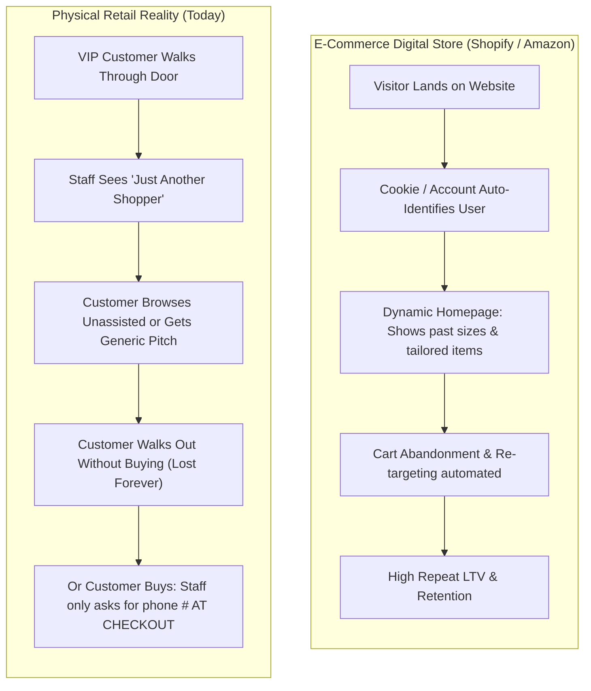

Traditional retail loyalty programs fail because they are **100% reactive**:
1. **Friction at Checkout:** Asking a busy customer for their phone number, email, or a physical plastic card creates checkout friction. Over 75% of shoppers decline to give their details.
2. **Too Late to Influence the Sale:** Identifying a customer *at the cash register* does nothing to help the sales associate guide their purchase, recommend matching inventory, or personalize the floor experience while they are browsing.
3. **Staff Turnover Erases Customer Memory:** When a star salesperson leaves a boutique, their mental database of customer preferences, sizes, and purchase histories leaves with them. New staff are left completely blind.

**VisitMemory's Value Proposition:** Identify the high-value shopper at the entrance threshold. Dispatch a private, contextual alert (*"Alex is back — Bought Floral Dress RM589 4 mos ago — Prefers Pastel Linen"*) to the staff's smartphone or POS within 800 milliseconds, turning junior clerks into luxury-grade personal concierges.

---

### 1.2 Go/No-Go Verdict: **CONDITIONAL GO**

* **Commercial Feasibility:** **Extremely High.** SMB retailers lose thousands in lost repeat sales. At $39–$79/month, converting just **one additional high-ticket sale per quarter** provides a 300% to 1,000% ROI on the subscription.
* **The Strategic Condition:** Development must strictly follow a **staged roadmap**. Building complex POS integrations before proving floor staff engagement causes fatal startup churn. Stage 1 must validate edge recognition reliability and staff workflow adoption using simple messaging tools (Telegram/WhatsApp) before scaling automated billing integrations.

---

## 2. Market Opportunity & Ideal Customer Profile (ICP)

Not every retail store is a fit for VisitMemory. High-velocity, low-basket businesses (e.g., convenience stores, fast-food outlets, high-volume coffee shops) will fail: staff will suffer notification fatigue within 2 hours and mute the alerts.

The platform is designed exclusively for the **"Goldilocks Zone"**: businesses characterized by **High Basket Size ($100–$2,000+)**, **Moderate Foot Traffic (10–60 visitors/day)**, and **High Relationship-Driven Repeat Purchase Value**.

### 2.1 Visual Market Segmentation: The "Goldilocks Zone"

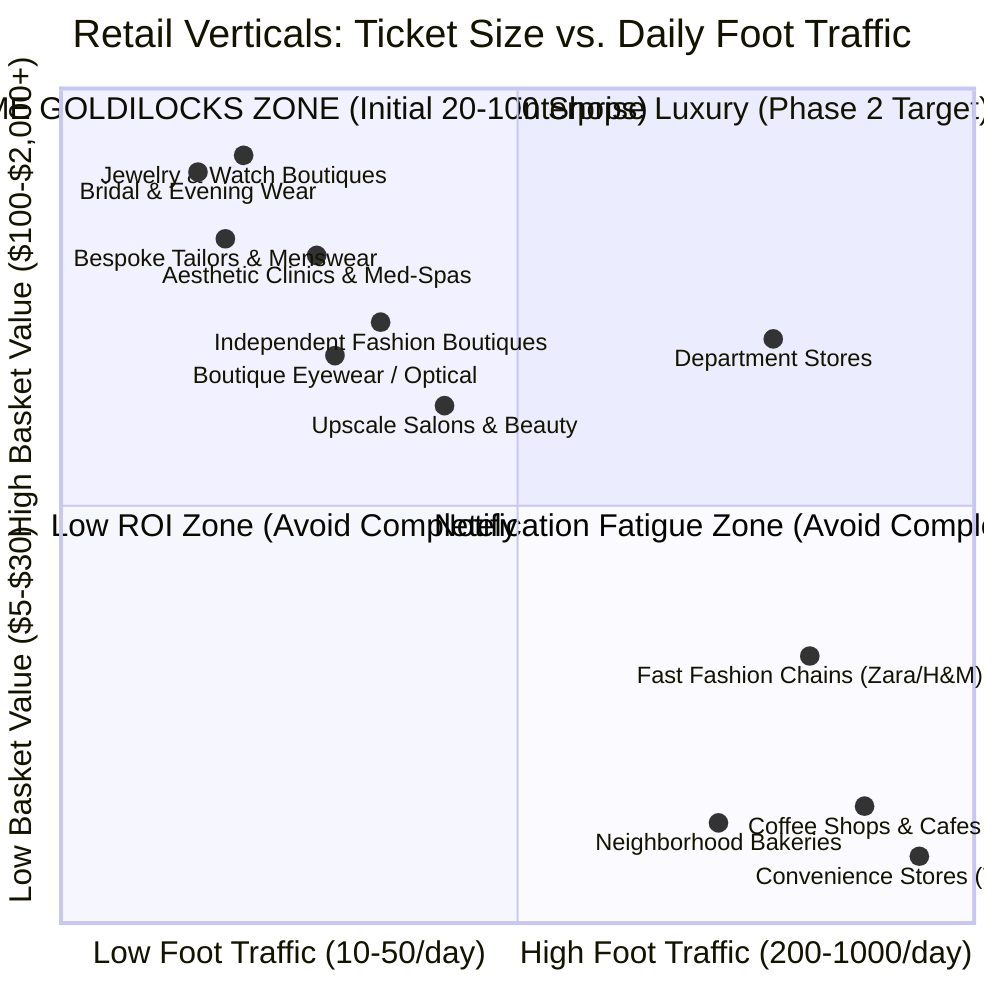

---

### 2.2 Target Vertical Breakdown & Store Owner ROI Math

| Priority | Target Retail Vertical | Daily Visitors | Avg. Basket Size | Customer Return Cycle | The Owner's ROI Math ($39–$79/mo Plan) |
| :---: | :--- | :---: | :---: | :---: | :--- |
| **#1** | **Independent Fashion & Ethnic Boutiques** | 25 – 60 | $100 – $400<br>*(RM450–1,800)* | 2 – 4 Months<br>*(Seasonal / Festive)* | A boutique converting **just 1 extra walk-in per month** by recognizing a returning buyer's style generates an extra $200–$400 in gross margin, yielding a **5x to 10x ROI** on the subscription. |
| **#2** | **Bespoke Tailors & Bridal Salons** | 10 – 30 | $250 – $2,000+ | 6 – 12 Months<br>*(Milestones)* | Remembering a groom's alteration notes or a bride's style preference after 6 months makes the customer feel valued, securing multi-thousand-dollar wedding packages. |
| **#3** | **Aesthetic Clinics, Dental & Med-Spas** | 15 – 45 | $150 – $1,000 | 1 – 3 Months<br>*(Treatment Cycles)* | Front-desk receptionists rotate frequently. When a new receptionist greets a premium aesthetics patient by name before they state their appointment, client retention increases by over 30%. |
| **#4** | **Jewelry, Luxury Watches & Optical** | 15 – 40 | $200 – $5,000 | 3 – 8 Months | High percentage of shoppers "window shop" on visit 1 and return 3 weeks later to buy. Knowing what showcase they examined allows senior sales staff to close immediately. |

---

## 3. Competitive Landscape & Strategic Differentiation

Physical retail technology currently forces store owners into two unsatisfactory extremes: un-actionable enterprise hardware or reactive POS loyalty programs.

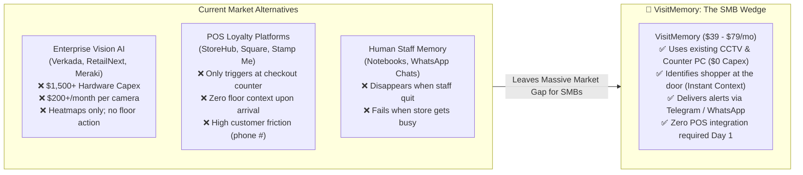

### Detailed Competitor Comparison Matrix

| Feature / Capability | Enterprise Vision AI (RetailNext, Verkada) | POS Loyalty Apps (Square, Stamp Me) | Manual Store Notebooks | VisitMemory |
| :--- | :--- | :--- | :--- | :--- |
| **Hardware Capex** | $1,500 – $10,000+ (Specialty cameras) | $0 (Uses POS terminal) | $0 | **$0 (Uses existing CCTV & PC)** |
| **Monthly Subscription** | $150 – $400 / store / mo | $30 – $90 / store / mo | $0 | **$39 – $79 / store / mo** |
| **Deployment Time** | 2–6 Weeks (Professional wiring) | 1 Hour | Immediate | **15 Minutes (Self-serve or USB)** |
| **Trigger Point** | Post-visit analytics dashboard | Post-selection checkout counter | When staff remembers | **Doorway entrance threshold (<800ms)** |
| **Staff Floor Actionability**| None (Executive heatmaps/counts) | None (Cashier points screen) | Inconsistent | **High (Direct smartphone prompt)** |
| **Customer Friction** | None | High (Must provide phone/email) | None | **Zero (Seamless biometric recognition)** |

---

## 4. Deep-Dive Unit Economics, Pricing Strategy & Scaling Math

### 4.1 Granular Cost of Goods Sold (COGS) Breakdown per Store ($39/mo Tier)

Assuming an average boutique experiences **40 visitors per day** ($\approx 1,200 \text{ face detections/month}$) and dispatches **600 notifications/month** (300 VIP arrival cards + 300 checkout/provisional logs):

| Operational Expense Item | Telegram Delivery Tier | WhatsApp Business API Tier | Cost Drivers & Optimization Notes |
| :--- | :---: | :---: | :--- |
| **Biometric Face Search Engine** | $1.23 | $1.23 | AWS Rekognition: 1,200 checks $\times \$0.0010 + 30$ provisional vector store fees. |
| **Receipt AI OCR** | $0.02 | $0.02 | Gemini Flash API: 150 receipt photos $\times \$0.0001$. |
| **Cloud Compute & PostgreSQL** | $1.50 | $1.50 | Allocated share of FastAPI instance, Redis, and Supabase DB. |
| **Cloudflare R2 Object Storage** | $0.00 | $0.00 | **$0 Egress.** 1,200 crops $\times 50\text{KB} = 60\text{MB/mo}$ (Free tier covers initial scale). |
| **Messaging Channel API** | **$0.00** | **$4.20** | Telegram Bot API is **100% free**; WhatsApp Utility API costs $\approx \$0.007$ per message. |
| **Stripe Payment Processing** | $1.43 | $1.43 | Standard 2.9% + $0.30 per successful monthly transaction. |
| **Total Monthly COGS Per Store**| **$4.18 / month** | **$8.38 / month** | **Ultra-low variable infrastructure overhead.** |
| **Net Gross Profit Per Store** | **$34.82 / month** | **$30.62 / month** | **Pure operational cash flow.** |
| **Gross Margin (%)** | **89.3%** | **78.5%** | **Software-grade margin profile.** |

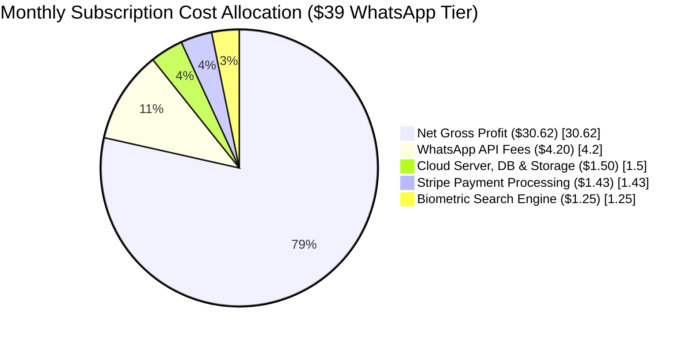

> **Pricing Optimization:** Default all early access stores to **$39/month with unlimited Telegram alerts**. Package **WhatsApp Group Alerts** as an upsell at **$59/month** to protect gross margins above 80%.

---

### 4.2 Smart Tiered Pricing Strategy (Increasing Average Revenue Per User)

| Tier Name | Monthly Fee | Cameras Supported | Included Features | Target Merchant Profile | Gross Margin |
| :--- | :---: | :---: | :--- | :--- | :---: |
| **Starter (Early Access)** | **$39 / mo** | 1 Camera *(Entrance)* | Unlimited Telegram alerts, manual chat tagging, 1,500 visits/mo, 24-hr privacy purge. | Single-door boutique, tailor, independent salon. | **89.3%** |
| **Growth (Pro Floor)** | **$59 – $79 / mo** | 2 Cameras *(Door + Counter)* | Official WhatsApp group alerts, AI Receipt Photo OCR, Staff Ignore List, 4,000 visits/mo. | Busy fashion boutiques, med-spas, aesthetics clinics. | **82.5%** |
| **Enterprise / Multi-Branch** | **$99 – $149 / mo** *(per store)* | Up to 4 Cameras *(Multi-Zone)* | Split-Mode POS Spooler Sync, Multi-Branch VIP Roaming, Jev Decision Upsell, CSV/CRM Export. | Multi-location luxury chains, jewelry chains (3–15 branches). | **85.0%** |

---

### 4.3 Financial Scaling Trajectory: 5 to 100 Shops (MRR vs. Cloud COGS)

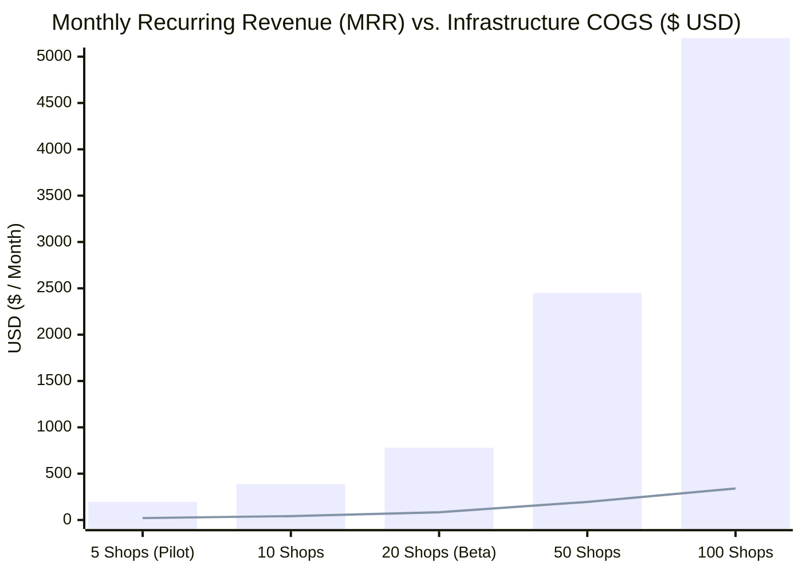

#### Why Infrastructure Costs Stay Flat While Revenue Scales:
* **Shops 1 to 30:** Pay-as-you-go serverless models (AWS Rekognition + Supabase + Cloudflare R2) eliminate fixed monthly server capex. Variable cost is strictly $\approx \$4.18$ per store.
* **Shops 30 to 100+:** The platform transitions from AWS Rekognition to a dedicated **$45/month Cloud GPU** (RunPod/Hetzner) running quantized commercial ONNX embeddings with **Qdrant**. That single GPU instance can execute over 500,000 biometric comparisons monthly, capping total AI compute costs while revenue surpasses **$5,000/month**.

---

## 5. The 18-Month Roadmap to $100,000 MRR

Achieving $100k MRR ($1.2M ARR) requires transitioning from direct founder walk-in sales to high-velocity channel distribution and multi-location enterprise contracts.

```
┌────────────────────────────────────────────────────────────────────────────────────────┐
│                        THE 18-MONTH PATHWAY TO $100,000 MRR                            │
├─────────┬──────────────┬──────────────┬──────────────────┬─────────────────────────────┤
│ Phase   │ Timeline     │ Target Stores│ Target Blended   │ Target MRR                  │
│         │              │              │ ARPU             │                             │
├─────────┼──────────────┼──────────────┼──────────────────┼─────────────────────────────┤
│ Phase 1 │ Months 1–3   │ 20 – 40      │ $39 / mo         │ $1,000 – $1,500 MRR         │
│ Phase 2 │ Months 4–6   │ 120 – 160    │ $75 / mo         │ $10,000 – $12,000 MRR       │
│ Phase 3 │ Months 7–12  │ 500 – 600    │ $85 / mo         │ $42,000 – $51,000 MRR       │
│ Phase 4 │ Months 13–18 │ 1,050 – 1,200│ $95 / mo         │ $100,000+ MRR               │
└─────────┴──────────────┴──────────────┴──────────────────┴─────────────────────────────┘
```

---

### 5.1 Phase-by-Phase Execution Plan

#### Phase 1: Validation & Lighthouse Case Studies (Months 1–3) $\rightarrow$ $1,000 to $1,500 MRR
* **Core Objective:** Validate floor reliability, eliminate false positives, and establish 3 referenceable store case studies.
* **Product Focus:** Desktop Window Grabber + AWS Rekognition + Telegram Bot.
* **Milestone:** 25 paying stores at $39/mo. Capture a high-impact, 30-second video of an owner explaining how recognizing a returning VIP generated an incremental $500 sale.

#### Phase 2: Deploy Automatic POS Matching & Double ARPU (Months 4–6) $\rightarrow$ $10,000 to $12,000 MRR
* **Core Objective:** Eliminate manual cashier tagging friction to eliminate Month-3 churn.
* **Product Focus:** Release the **2MB Print Spooler Listener** and **Multi-Zone Counter Camera Ingestion**.
* **Commercial Strategy:** Grandfather initial beta shops; price all new onboarding merchants at **$79/month** for Automated POS Matching.

#### Phase 3: The Multi-Branch VIP Roaming Feature (Months 7–12) $\rightarrow$ $42,000 to $51,000 MRR
* **Core Objective:** Target multi-outlet retail chains (3 to 20 stores per owner).
* **The Product Moat:** **Shared Chain Memory.** If a client buys a gown at Branch A (Downtown), and enters Branch B (Suburbs) 3 months later, Branch B's staff immediately receives: *"VIP from Downtown Branch just walked in — Prefers Silk Size M"*.
* **Commercial Strategy:** Charge **$99/month per branch**. Closing a single 10-store optical or bridal chain adds **$990/month in MRR** from a single contract.

#### Phase 4: Geographic Expansion & CCTV Dealer Scale (Months 13–18) $\rightarrow$ $100,000+ MRR
* **Core Objective:** Scale across regional retail hubs (**Kuala Lumpur, Singapore, Dubai, Mumbai/Delhi, Bangkok**) entirely through channel resellers.
* **Execution:** Recruit 30–50 regional security installation agencies, providing them with automated 25% rev-share contracts.

---

### 5.2 The 3 Scaling Bottlenecks and Proactive Solutions

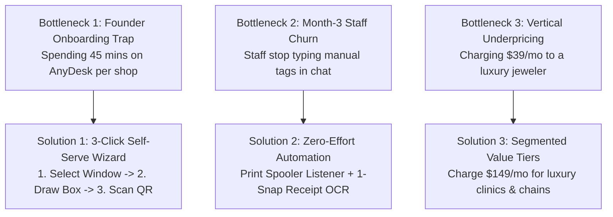

---

## 6. Go-To-Market Playbook & Channel Partner Distribution

Cold emailing and Google Ads are ineffective for independent retail owners. Store owners spend their days on the retail floor or communicating via WhatsApp/Instagram. Distribution relies on two complementary motions: direct founder onboarding for the first 20 stores, transitioning to local CCTV dealers for rapid scaling.

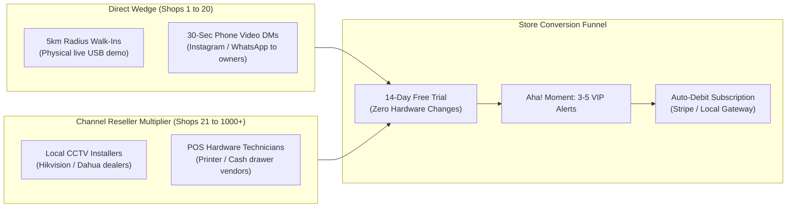

---

### 6.1 The "Trojan Horse" Distribution Engine: Local CCTV Technicians

Independent CCTV dealers and technicians represent the single highest-leverage distribution channel for VisitMemory.

#### Why CCTV Dealers Are Desperate for VisitMemory:
1. **Vanishing Hardware Margins:** Retailers cross-reference camera hardware prices on Amazon and Shopee, eroding installer hardware markups to near zero.
2. **Transactional Revenue Trap:** Technicians earn a one-time setup fee ($100–$300) and earn $0 in recurring revenue from that store for the next 3 years.
3. **Goldmine of Trusted Client Contacts:** An established technician maintains direct phone relationships with **150 to 500 store owners**, holds their NVR admin passwords, and has trusted access to their computer systems.

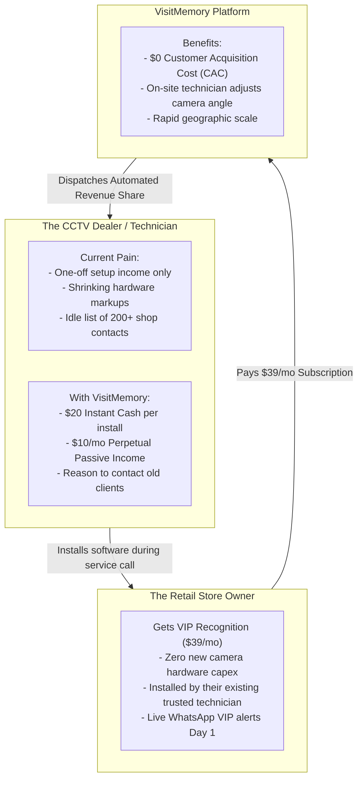

---

### 6.2 The Dealer Hybrid Commission Structure

Technicians operate on weekly cash flow. A delayed "revenue share only" model fails to motivate them. A **hybrid model combining an upfront cash bounty with perpetual recurring revenue** aligns incentives effectively:

```
┌────────────────────────────────────────────────────────────────────────────────────────┐
│                        DEALER HYBRID COMPENSATION FORMULA                              │
├────────────────────────────────────────────────────────────────────────────────────────┤
│ 1. Upfront Activation Bounty   │ $20.00 cash upon customer's first paid subscription  │
│ 2. Monthly Recurring Share     │ $10.00 / month (25%) every month the shop stays active│
└────────────────────────────────┴───────────────────────────────────────────────────────┘
```

#### Annual Technician Earnings Projection Sheet

| Active Client Stores | Instant Activation Bonus | Monthly Passive Income | Total Annual Extra Income |
| :---: | :---: | :---: | :---: |
| **5 Stores** *(1 week of calls)* | $100 | $50 / month | **$700 / year** |
| **25 Stores** *(10% of client book)*| $500 | $250 / month | **$3,500 / year** |
| **50 Stores** *(Premier Partner)* | $1,000 | $500 / month | **$7,000 / year** *(Covers van/rent)* |

#### Company Unit Economics with Dealer Payouts:
* **Month 1:** Store pays $39. Company pays $20 bounty + $10 recurring = $30. Server COGS = $4.18. **Company earns $4.82 profit in Month 1 ($0 ad spend).**
* **Month 2 Onward:** Store pays $39. Company pays $10 recurring. Server COGS = $4.18. **Company nets $24.82 in monthly profit per store.**

---

### 6.3 Managing the 3 Real-World Dealer Traps

1. **Trap 1: Technicians Are Ineffective Software Salespeople.**
   * *Mitigation:* Never require technicians to explain software or pitch CRM concepts. Equip them with a **30-second silent phone demo video** and a 2-sentence script:
     > *"Boss, your entrance camera is clear enough to turn on VIP WhatsApp alerts for returning customers. Watch this 20-second video—since I'm already servicing your PC, want me to activate the 14-day free trial?"*
2. **Trap 2: Cash Collection Disputes.**
   * *Mitigation:* Never allow technicians to collect subscription payments in cash. All stores register payment via direct automated credit card / payment gateway links. The instant payment succeeds, the technician's partner bot pings them: *"🎉 Boutique X renewed! $10 added to your account."*
3. **Trap 3: Activation Bonuses on Ineffective Camera Angles.**
   * *Mitigation:* The $20 bounty is disbursed **only** after the camera feed passes the automated face quality verification gate ($\ge 80 \times 80\text{px}$ frontal crops) AND the merchant completes their first paid monthly billing cycle.

---

### 6.4 The 48-Hour Dealer Recruitment Script

1. Identify independent CCTV installers with 10–50 Google reviews in targeted commercial retail districts.
2. Direct Outreach Script (WhatsApp / Phone):
   > *"Hi [Name], I run a software platform that integrates with existing Dahua and Hikvision installations in clothing boutiques, salons, and clinics to recognize returning VIP customers on WhatsApp. We don't sell hardware—we partner with local CCTV specialists and pay **$20 upfront cash + $10 recurring every month** for every existing client where you enable it. Can I buy you a 10-minute coffee tomorrow to show you how it works on my laptop?"*

---

### 6.5 Direct Sales Playbook: The 90-Day 0-to-20 Store Roadmap

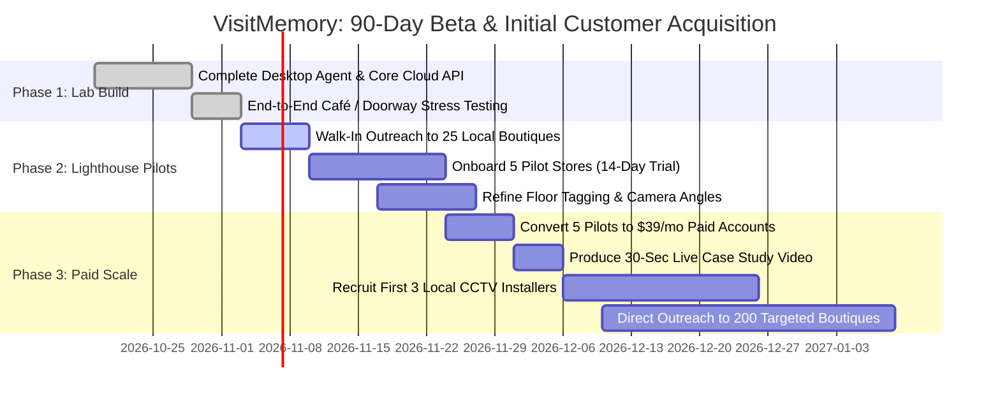

#### Step 1: The 5 Lighthouse Shops (Concierge Walk-In Setup)
* Walk into 25 independent boutiques, tailors, or clinics within a 5km radius that have a visible dome camera near the entrance and a PC on the counter.
* The 30-Second Walk-In Founder Pitch:
  > *"You already have an entrance camera and a counter PC. I developed a lightweight program that links to your camera screen and messages your staff's WhatsApp whenever a high-spending customer returns, displaying what they bought last time. Zero hardware needed. I'm setting up 5 pilot shops on this street for a free 14-day trial—can I set it up on your PC in 3 minutes?"*
* Install via USB drive on the spot, configure the camera window, and trigger the first detection by walking out the door yourself.

---

## 7. Store Floor Operations: Staff Enablement & The Hospitality Protocol

The primary reason in-store retail software gets abandoned is **staff operational resistance**. If logging an interaction requires more than 10 seconds, sales clerks will ignore the system.

### 7.1 Daily Staff Workflow Architecture

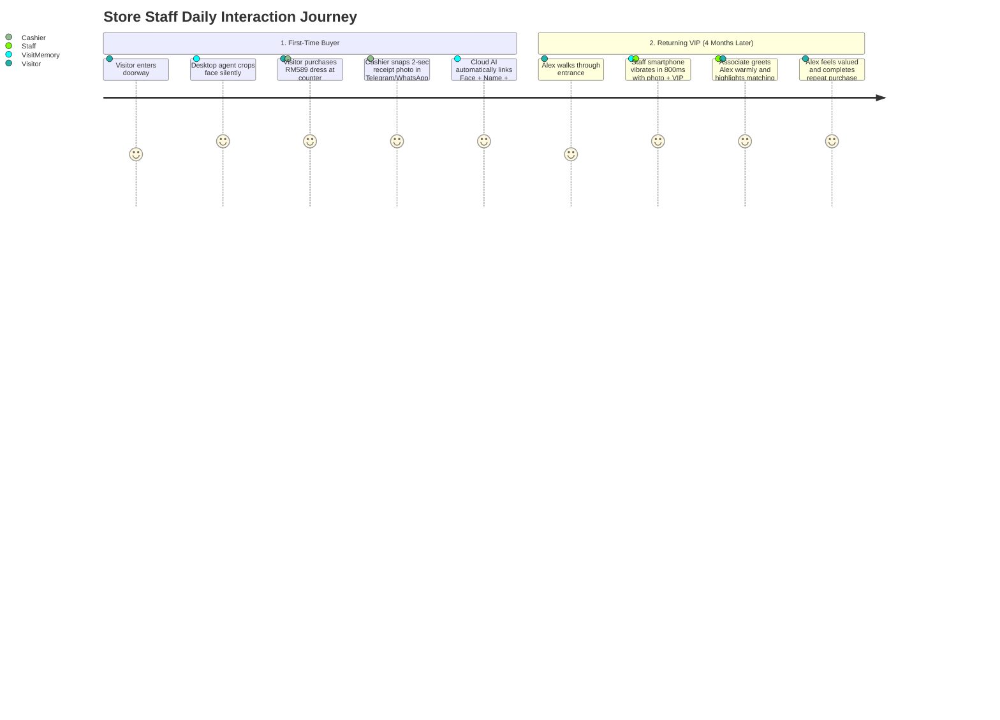

---

### 7.2 Solving the "Creep Factor": The Floor Staff Hospitality Protocol

If an employee greets a shopper with: *"Hello Alex, our facial recognition camera alerted us that you bought a dress 4 months ago,"* the customer will feel unsettled. 

Store onboarding includes a one-page **Hospitality Protocol**:

```
┌────────────────────────────────────────────────────────────────────────────────────────┐
│                           THE HOSPITALITY CHEAT SHEET                                  │
├────────────────────────────────────────────────────────────────────────────────────────┤
│ RULE 1: For Established VIP Regulars                                                   │
│ Greet by name naturally: "Welcome back, Alex! Wonderful to see you again!"             │
│ High-value clients expect luxury boutiques to remember their identity.                 │
├────────────────────────────────────────────────────────────────────────────────────────┤
│ RULE 2: For Infrequent Shoppers (New Staff on Duty)                                   │
│ Use CONTEXT, never SURVEILLANCE:                                                       │
│ ❌ DO NOT SAY: "Our AI camera scanned your face at the door."                          │
│ ✅ DO SAY:     "Welcome in! How did that silk summer dress work out for you?"          │
│ Frame knowledge as seamless boutique team communication rather than computer tracking.│
└────────────────────────────────────────────────────────────────────────────────────────┘
```

---

## 8. Sales Objection Battlecard

| Store Owner Objection | Underlying Concern | Proven Field Response |
| :--- | :--- | :--- |
| **"Will this slow down my billing computer?"** | Fear of POS freezing during checkout. | *"The agent runs locally at less than 3% CPU load and uses less memory than a single browser tab. It only samples 2 frames per second. If it ever impacts your PC, you can remove it in one click."* |
| **"My staff are too busy to type in customer details."** | Staff burnout and operational friction. | *"Staff never have to type long notes. At checkout, they simply snap a 2-second photo of the printed receipt in WhatsApp. Our AI reads the items and total automatically. Tagging just 2 VIPs a day builds a bank of 60 high-value profiles every month."* |
| **"We already have a loyalty program on our POS."** | Believes current tools solve the problem. | *"Your POS loyalty program only identifies who a customer is after they walk up to pay. VisitMemory alerts your team 3 seconds after they cross the front door—giving your staff the context they need to assist them while they are still browsing."* |
| **"I don't want software touching my billing or financial records."** | Paranoia over tax records and total store revenue. | *"We never connect to your billing database or read your accounting books. The software only reads the item description on individual receipts printed at the counter—functioning exactly like an assistant noting down an item name on a notepad."* |
| **"What about customer biometric privacy?"** | Fear of legal liability and customer pushback. | *"We never store raw surveillance video. Unrecognized visitors who don't join your VIP list are automatically purged from the system within 24 hours. The platform operates strictly as a digital clienteling notebook for consenting regular customers."* |
| **"What if our store internet drops?"** | Unstable retail Wi-Fi connectivity. | *"The edge agent includes an offline local spool. It queues detections locally and syncs with the cloud automatically the second connectivity is restored, ensuring no data loss."* |

---

## 9. The 30-Day Beta Scorecard & Decision Framework

Deploy the Stage 1 MVP across **5 pilot retail locations** for 30 days. Evaluate platform viability strictly against the following quantitative criteria before committing engineering resources to Stage 2 automated billing integrations.

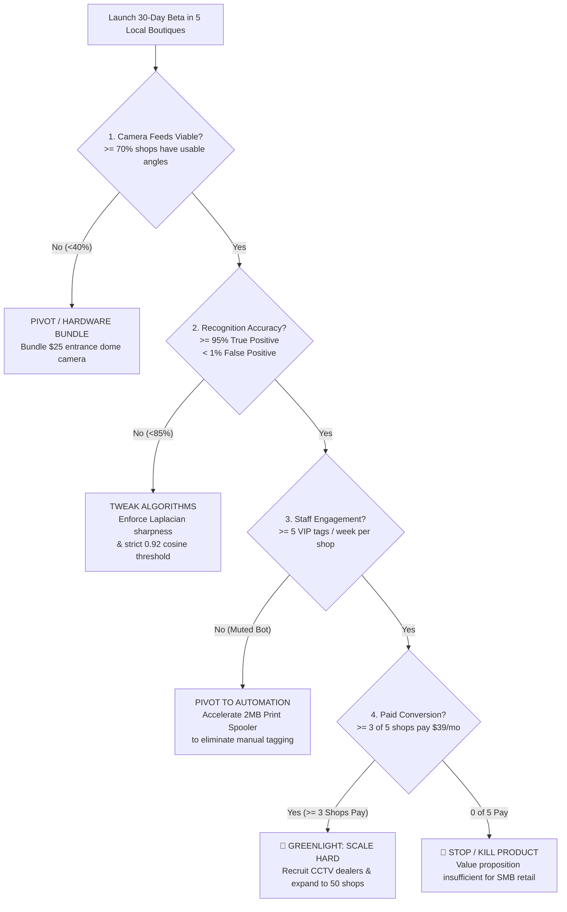

### Quantitative Beta Metrics Matrix

| Evaluation Dimension | 🟢 Greenlight (Scale Hard) | 🟡 Pivot / Optimize | 🔴 Kill / Cease Operations |
| :--- | :--- | :--- | :--- |
| **Camera Viability** | $\ge 70\%$ of stores have an entrance camera angle capable of capturing $\ge 80 \times 80\text{px}$ crops. | $40\%–69\%$ viable; requires partner technician to adjust mount angle. | $<30\%$ viable; existing retail cameras are unusable without full replacements. |
| **Biometric Accuracy** | $>95\%$ true positive match rate on returning VIPs; $<1\%$ false positives. | $85\%–94\%$ accuracy; requires multi-frame embedding aggregation. | $<85\%$ accuracy under realistic store lighting conditions. |
| **Floor Engagement** | Staff tag $\ge 5$ customer profiles per store per week via messaging bot. | Staff read incoming alerts but neglect manual tagging after week 1. | Staff mute or disable the notification bot within 7 days. |
| **Paid Conversion** | $\ge 3$ out of 5 pilot stores convert to paid $39/mo subscriptions after trial. | Stores request extended trial periods or specific feature enhancements. | 0 out of 5 stores demonstrate willingness to pay $39/mo. |
