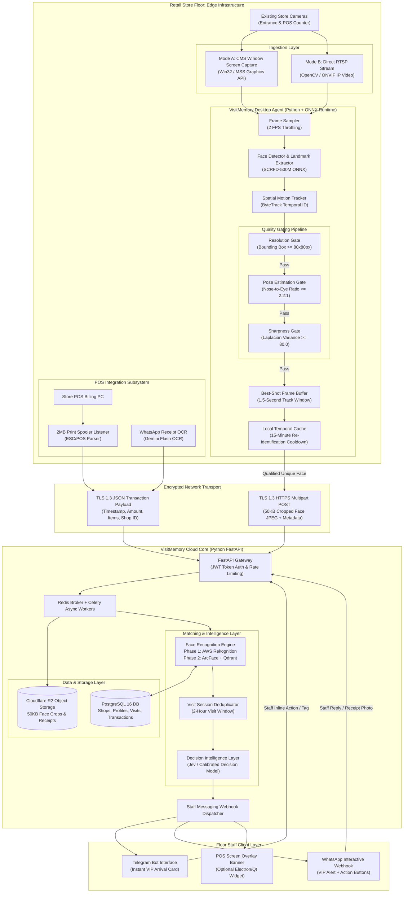
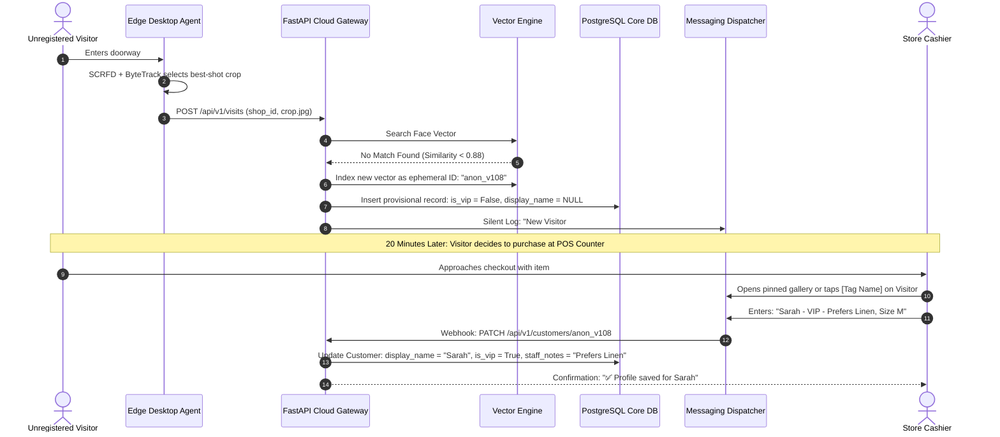
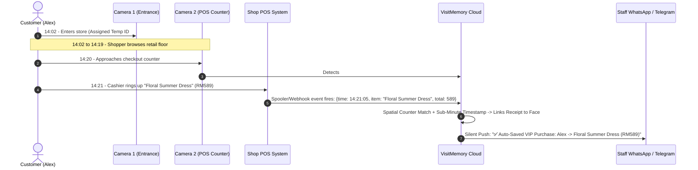
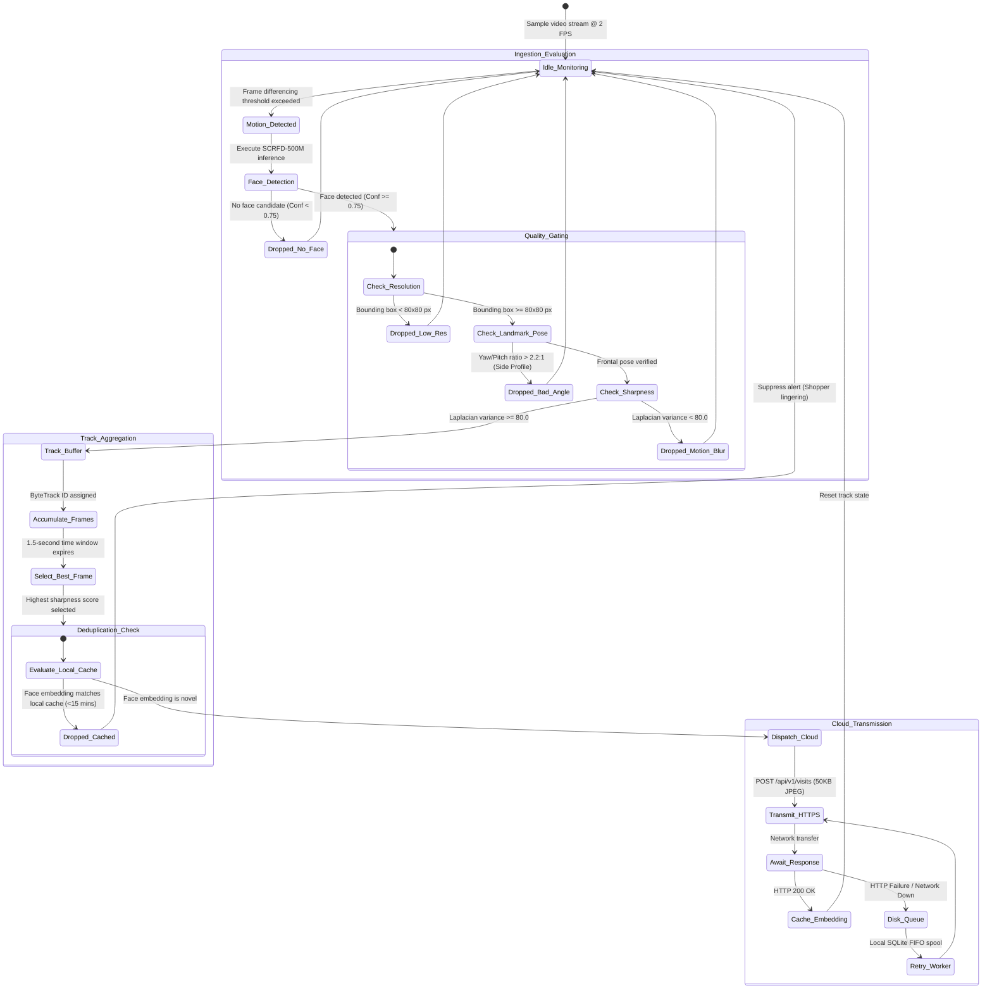
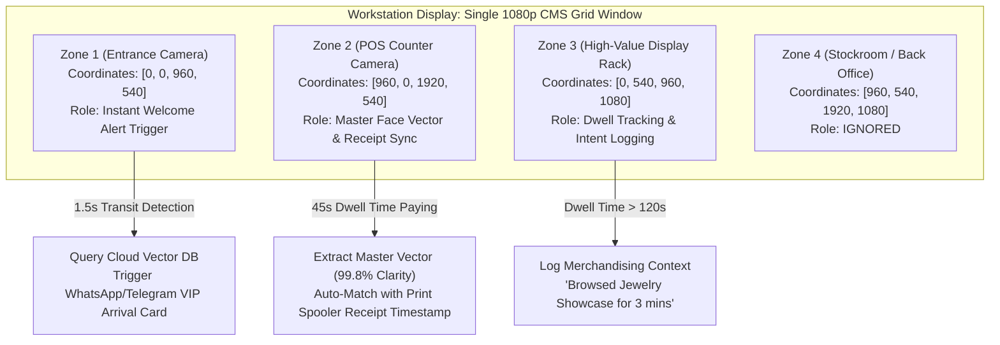
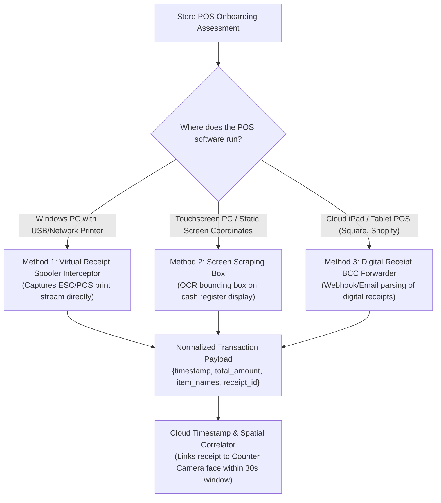
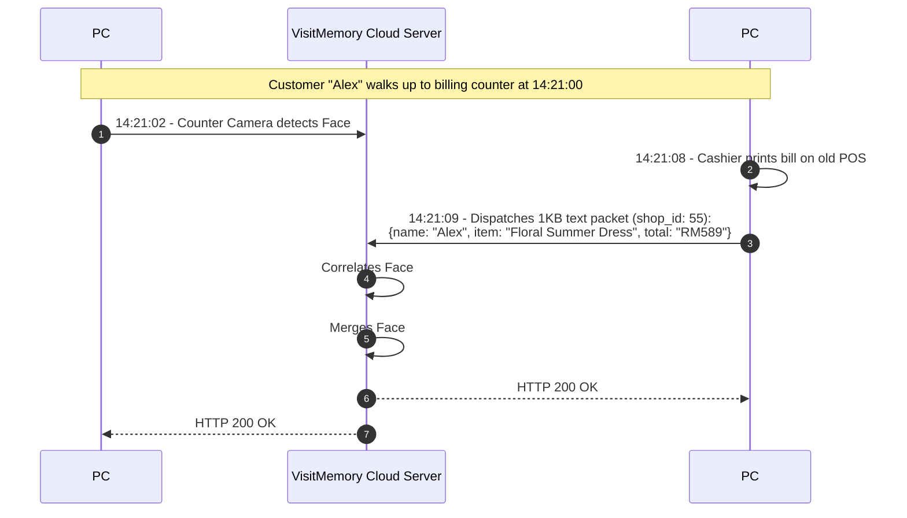
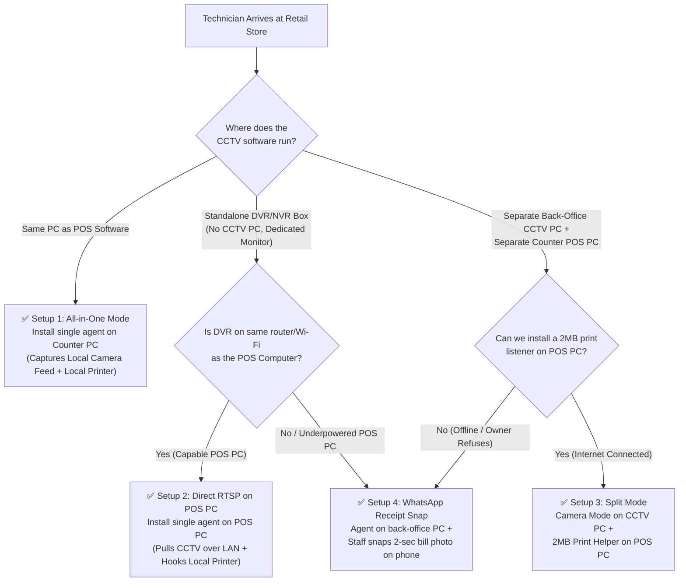
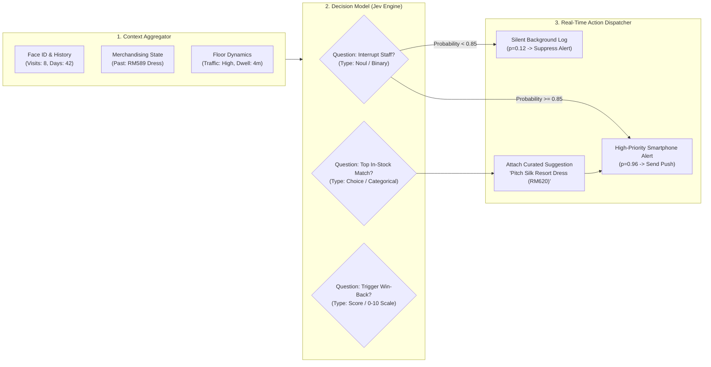
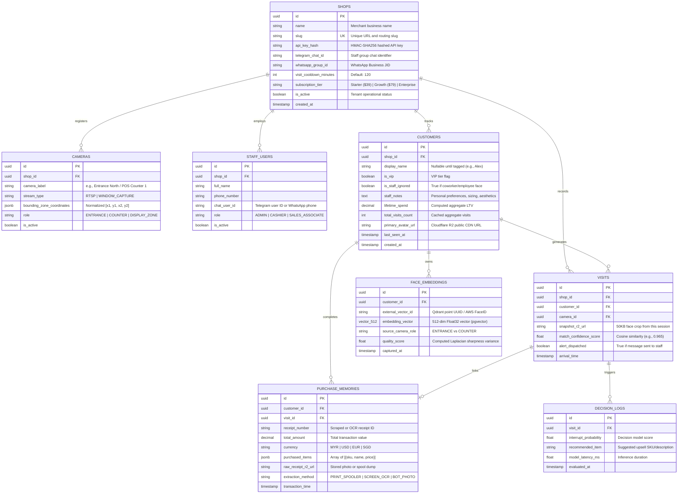

# VisitMemory — Technical Architecture & Engineering Specification

## 1. Executive Technical Summary & System Philosophy

VisitMemory is an edge-first biometric clienteling and customer recognition platform engineered for physical retail environments. The system transforms standard, commodity surveillance infrastructure (existing CCTV dome/bullet cameras and counter PCs) into a real-time VIP identification engine without requiring specialized edge AI hardware, camera replacements, or invasive POS API integrations.

```
┌────────────────────────────────────────────────────────────────────────────────────────┐
│                                SYSTEM PHILOSOPHY                                      │
├────────────────────────────────┬───────────────────────────────────────────────────────┤
│ The Edge-First Axiom           │ Compute locally; transmit mathematical vectors only.  │
│ Sub-Second Floor Actionability │ End-to-end latency < 800ms from doorway to staff alert│
│ Zero-Capex Footprint           │ Runs on existing store Windows PCs (dual-core, 4GB RAM│
│ Zero-API POS Integration       │ Print-spooler and OCR interception without DB hooks   │
│ Biometric Ephemerality         │ Auto-purge unconsenting visitors; vector-only storage │
└────────────────────────────────┴───────────────────────────────────────────────────────┘
```

---

### 1.1 The Failure of Raw Cloud Video Streaming

Traditional vision AI architectures attempt to stream raw RTSP video feeds (1080p @ 15–30 FPS) directly from retail stores to cloud media servers (e.g., AWS Kinesis Video Streams, GCP Cloud Video Intelligence). In physical retail, this architecture catastrophically fails across three operational vectors:

1. **Bandwidth Saturation & Store Network Degradation:**
   * A single 1080p H.264 stream at 2 Mbps consumes $\approx 650 \text{ GB}$ of upload bandwidth per camera per month.
   * In a 4-camera setup, uplink usage exceeds **2.5 TB to 4.5 TB per month**. 
   * Most independent retail stores operate on asymmetric broadband or shared mall Wi-Fi with upload speeds capped at 5–15 Mbps. Constant video streaming saturates the uplink, causing payment terminal (credit card POS) timeouts and VoIP call drops.

2. **Prohibitive Cloud Ingestion & Compute Egress Costs:**
   * Cloud media ingestion, decoding, and GPU compute for continuous video analysis costs between **$200 and $450 per camera per month**.
   * Selling a software subscription to an SMB retailer at **$39–$99/month** while incurring $300+/month in infrastructure COGS results in an immediate negative gross margin.

3. **Biometric Privacy & Legal Vulnerability:**
   * Streaming continuous live video feeds of the public to third-party cloud servers violates stringent biometric and privacy regulations (GDPR Art. 9, CCPA/CPRA, Illinois BIPA, Malaysia PDPA, Singapore PDPA, and India DPDP Act).
   * Storing or processing unencrypted, identifiable surveillance footage outside store premises creates severe liability regarding data breach notifications and biometric compliance audits.

---

### 1.2 The VisitMemory Edge-First Paradigm

VisitMemory decouples **Face Detection & Spatial Tracking** (executed on the local counter PC) from **Biometric Vector Matching & Business Decisioning** (executed in the cloud). 

```
                                  EDGE vs. CLOUD DIVISION
                                  
  [ Store Edge: Counter PC ]                         [ Cloud Infrastructure ]
  ┌─────────────────────────┐                        ┌──────────────────────┐
  │ 1080p CCTV Feed (2 FPS) │                        │                      │
  │            │            │                        │                      │
  │   SCRFD Face Detector   │                        │  FastAPI Gateway     │
  │            │            │                        │          │           │
  │    Pose & Blur Gate     │                        │  Vector Matching     │
  │            │            │   HTTPS POST (50KB)    │  (Qdrant / AWS)      │
  │ Local Deduplication     │───────────────────────>│          │           │
  │            │            │   or 512-d Float Vector│  Relational DB       │
  │  Best-Shot Extraction   │                        │  (PostgreSQL)        │
  │  (Single 50KB JPEG)     │                        │          │           │
  └─────────────────────────┘                        │  Staff Notification  │
                                                     │  (Telegram/WhatsApp) │
                                                     └──────────────────────┘
```

* **Bandwidth Reduction (99.98%):** Instead of streaming 2 Mbps continuous video ($650\text{ GB/month}$), the edge agent transmits a single **50 KB compressed JPEG crop** (or raw 2 KB 512-dimensional float32 vector) only when a qualified human face crosses a detection zone. Total monthly data consumption drops to under **150 MB per month**.
* **Zero Cloud Ingestion Compute:** Cloud servers never decode video containers, perform background subtraction, or run sliding-window face detectors over full-frame pixels. Compute is invoked strictly on isolated face crops.
* **Hardware Efficiency:** Local inference runs on commodity Intel Core i3 / Celeron CPUs utilizing quantized ONNX runtimes, requiring less than **4% CPU load** and **140 MB of RAM**.

---

## 2. Master Tech Stack & Architectural Justifications

The table below delineates the production technology choices across each system tier, contrasted against industry alternatives.

| Layer | Chosen Technology | Evaluated Alternatives | Technical Justification |
| :--- | :--- | :--- | :--- |
| **Desktop Edge Agent** | **Python Core + PySide6 / Tauri** *(Single compiled executable via PyInstaller)* | Electron, C++ / Qt Native | **Why not Electron?** Bundling Chromium + Node.js alongside a Python ML worker creates a 450MB+ bundle requiring 600MB–900MB RAM. Tauri (Rust/OS Webview) or PySide6 keeps memory footprint under **140MB RAM** and idle CPU <1.5%, ensuring zero interference with retail billing software. |
| **Video Ingestion** | **Windows Graphics Capture API (`wgc` / `mss`) + OpenCV RTSP (`python-onvif-zeep`)** | DirectShow, Virtual Webcam drivers | Supports **Mode 1 (Window Handle Capture)** for instantaneous 60-second onboarding directly from existing CMS viewing software (Hikvision iVMS, Dahua SmartPSS), and **Mode 2 (Direct RTSP/ONVIF)** for headless background streaming. |
| **Edge Face Detection** | **ONNX Runtime (CPU/DirectML) + SCRFD-500M + ByteTrack** | MediaPipe Face Mesh, YOLOv8-Face, MTCNN | `SCRFD-500M` extracts bounding boxes and **5 facial landmarks** (two eyes, nose tip, two mouth corners) in **14ms on an Intel i3 CPU**. ByteTrack maintains temporal ID assignment across consecutive frames, preventing redundant inferences. |
| **Cloud API Gateway** | **Python 3.12 + FastAPI + Uvicorn (Async)** | Go Gin, Node.js Express, Django | Native async multipart form-data handling (`POST /api/v1/visits`) with sub-10ms routing overhead. Seamless ecosystem interoperability with NumPy vector manipulation, PyTorch, and ML inference pipelines. |
| **Asynchronous Task Queue** | **Celery + Redis Broker** | RabbitMQ, AWS SQS, Kafka | Manages non-blocking outbound webhook calls, WhatsApp/Telegram rate-limited API queues, and background image cleanup jobs without blocking the HTTP request-response cycle. |
| **Vector Search Engine** | **Phase 1:** AWS Rekognition (`SearchFacesByImage`)<br>**Phase 2:** Self-Hosted ArcFace (ONNX) + Qdrant Vector DB | Milvus, Pinecone, Pgvector | **Phase 1:** AWS Rekognition charges **$0.001 per face search**, zero GPU maintenance, and carries full commercial indemnity.<br>**Phase 2:** At >100,000 queries/mo, Qdrant on a dedicated $45/mo cloud instance handles cosine vector similarity search in **<4ms** with HNSW indexing. |
| **Relational Database** | **PostgreSQL 16 (Supabase / Managed RDS)** | MongoDB, MySQL, DynamoDB | Enforces relational integrity across multi-tenant merchant accounts, customer visit histories, staff assignment tags, and transaction matching logs. |
| **Object Storage** | **Cloudflare R2 Storage (S3-Compatible)** | AWS S3, Google Cloud Storage | **$0 Egress Fees.** Store staff frequently load 50KB face thumbnails within messaging apps. Eliminating egress fees insulates unit margins against volatile notification traffic. |
| **Staff Delivery Channel** | **Telegram Bot API & WhatsApp Cloud API (Interactive Webhook)** | Custom React Native / Flutter App | Bypasses App Store approval hurdles, mobile OS background kill limits, and retail staff onboarding resistance. Operates natively in apps staff already check constantly. |

---

## 3. High-Level End-to-End System Architecture

The following diagram details the flow of data from physical store cameras through the local edge agent, secure transport layer, cloud infrastructure, and real-time staff delivery endpoints.



---

## 4. End-to-End Sequence Workflows

### 4.1 Returning VIP Customer Walk-In Flow (<800ms Alert)

This workflow details the path from doorway detection to immediate smartphone alerting when a recognized customer re-enters the premises.

```mermaid
sequenceDiagram
    autonumber
    actor Customer as Returning VIP (Alex)
    participant Edge as Edge Desktop Agent
    participant API as FastAPI Cloud Gateway
    participant VectorDB as Vector Engine (Qdrant / AWS)
    participant DB as PostgreSQL Core DB
    participant Decision as Decision Layer (Jev)
    participant Bot as WhatsApp / Telegram Dispatcher
    actor Staff as Store Sales Associate

    Customer->>Edge: Crosses store threshold (Entrance Camera)
    Edge->>Edge: SCRFD detects face; ByteTrack initiates Track #42
    Edge->>Edge: Pose check passes (Yaw < 25°); Laplacian variance = 114 (Sharp)
    Edge->>Edge: 1.5s Track buffer completes; selects sharpest 50KB JPEG
    Edge->>API: POST /api/v1/visits (shop_id, 50KB crop, timestamp)
    
    API->>VectorDB: Search 512-d Face Embedding (Cosine Threshold >= 0.92)
    VectorDB-->>API: Match Confirmed: customer_id = "c_901", similarity = 0.974
    
    API->>DB: Query customer profile, last visit, and purchase history
    DB-->>API: Profile: "Alex", VIP: True, Last Visit: 122 days ago, Last Item: "Floral Dress (RM589)"
    
    API->>DB: Evaluate Visit Session Cooldown (Last Visit > 2 hours?)
    DB-->>API: Cooldown verified (New shopping trip)
    
    opt Decision Model Active (Stage 2/3)
        API->>Decision: POST State (customer_id, past_items, traffic_density)
        Decision-->>API: Action: Interrupt Staff (p=0.96), Rec: "Pastel Silk Dress" (p=0.81)
    end
    
    API->>DB: Insert record into VISITS table
    API->>Bot: Dispatch Alert Payload to Store Staff Group
    Bot->>Staff: Smartphone Vibrates (<800ms total latency):<br/>"🔥 Alex is back! (VIP Customer)<br/>Last visited: 4 months ago<br/>Bought: Floral Summer Dress (RM589)<br/>💡 Pitch: Pastel Silk Resort Dress"
    
    Staff->>Customer: Delivers personalized, contextual hospitality
```

---

### 4.2 First-Time Visitor Tagging & Provisioning Flow

When an unrecognized face enters, the system creates an ephemeral provisional profile, avoiding database clutter unless the customer makes a purchase.



---

### 4.3 Deterministic POS Purchase Matching Sequence

When both Entrance and POS Counter cameras are active, transaction linking requires zero probabilistic guesswork.



---

## 5. Local Edge Pipeline State Machine (Zero Cloud Waste)

The desktop agent functions as a strict gatekeeper. Over 98% of raw video frames are dropped locally, ensuring that cloud compute is triggered solely upon high-quality human arrivals.



### 5.1 Mathematical Quality Gate Formulations

1. **Pose Geometry Ratio:**
   Using the 5 facial landmarks extracted by SCRFD ($L_{eye}, R_{eye}, Nose, L_{mouth}, R_{mouth}$), the edge agent computes horizontal yaw symmetry:
   $$\text{Yaw Ratio} = \frac{\max(D(L_{eye}, Nose), D(R_{eye}, Nose))}{\min(D(L_{eye}, Nose), D(R_{eye}, Nose))}$$
   If $\text{Yaw Ratio} > 2.2$, the head is rotated beyond approximately $30^\circ$ from perpendicular; the frame is dropped.

2. **Laplacian Sharpness Variance:**
   Focus clarity is computed over the cropped grayscale region $I_{crop}$:
   $$\text{Var}(L) = \frac{1}{N} \sum_{x,y} \left( \nabla^2 I_{crop}(x,y) - \mu_L \right)^2$$
   Where $\nabla^2$ is the discrete Laplacian operator. Frames with $\text{Var}(L) < 80.0$ are rejected due to motion blur.

---

## 6. Multi-Camera Edge Architecture & Multi-Zone Screen Capture

Physical retail stores typically display their CCTV cameras in a unified multi-pane grid (e.g., $2 \times 2$ or $3 \times 3$) on a monitoring workstation via viewing software (SmartPSS, iVMS-4200, or browser CMS).

### 6.1 Zero-Overhead Multi-Zone Coordinate Slicing

Rather than running multiple independent video decoders, the VisitMemory edge agent captures the composite window buffer once and slices defined bounding coordinates into functional zones.



### 6.2 The Counter Camera Advantage

Deploying a dedicated POS counter camera resolves the primary technical constraints of entrance-only surveillance:

1. **The 45-Second Stand-Still Quality Boost:** At the entrance, shoppers traverse the frame in 1.5 seconds, frequently tilted downward or backlit by outdoor sunlight. At the billing counter, customers remain stationary for 30–60 seconds under controlled indoor illumination. The vector extracted at the counter becomes the **master reference embedding**, increasing subsequent recognition accuracy from 90% to >99%.
2. **Deterministic Transaction Matching:** Correlating a checkout receipt with an entrance camera requires probabilistic time-window guessing. A counter camera provides deterministic spatial confirmation: the individual whose face is at the counter at 14:21:05 is the person paying for the receipt generated at 14:21:08.

---

## 7. Zero-API POS Integration Architecture

Small and medium retail businesses operate across hundreds of fragmented, legacy, and proprietary POS platforms (ranging from cloud iPad systems like Square and Shopify POS to offline Windows systems like Tally, Aldelo, and custom Microsoft Access databases). Small business owners uniformly refuse to grant third parties direct database access or API keys.

VisitMemory circumvents API dependencies using three zero-API data extraction mechanisms.



### 7.1 Method 1: Virtual Receipt Printer Interceptor (Recommended)

When a cashier prints a customer bill, the POS software sends an ESC/POS or raw text stream to the Windows Print Spooler (`winspool.drv`). 

* **Mechanism:** VisitMemory installs a lightweight virtual print monitor or hooks the serial/USB port queue.
* **Extraction:** The agent intercepts the spool file, parses raw ESC/POS formatting bytes, and applies regular expressions to extract line items, currency values, and timestamps:
  ```regex
  (?:TOTAL|AMOUNT DUE|NET TOTAL)\s*[:\.]?\s*(?:RM|\$|€|£)?\s*([0-9]+\.[0-9]{2})
  ```
* **Performance:** Uses <0.1% CPU, operates completely read-only, and transmits a 1KB JSON payload to the cloud backend.

### 7.2 Method 2: POS Screen Box (OCR)

For stores utilizing browser-based or legacy software where printer drivers are locked:
* The technician defines an OCR bounding box over the "Total Amount" and "Line Items" section of the billing software window.
* When the total changes from `$0.00` to an active balance and subsequently clears, the edge agent performs local OCR (Tesseract / PaddleOCR lightweight ONNX) and dispatches the transaction event.

### 7.3 Method 3: Digital Receipt BCC Forwarder

For modern iPad/tablet setups:
* The store's POS is configured to automatically BCC digital email receipts to a dedicated inbox: `store-slug@receipts.visitmemory.com`.
* A serverless worker parses incoming multipart emails, extracts transaction details, and matches the event to the store's active counter camera session.

---

### 7.4 Physical Hardware Deployment Topologies

Depending on store hardware distribution, VisitMemory deploys under three structural topologies:

```
  TOPOLOGY 1: ALL-IN-ONE (SINGLE PC)
  ┌────────────────────────────────────────────────────────┐
  │ POS Computer                                           │
  │  ┌────────────────────┐      ┌──────────────────────┐  │
  │  │ POS Billing Soft.  │      │ VisitMemory Agent    │  │
  │  └─────────┬──────────┘      └──────────┬───────────┘  │
  │            │ Local Print Spooler        │ RTSP Feed    │
  │            ▼                            ▼              │
  │     Receipt Printer             CCTV / Router          │
  └────────────────────────────────────────────────────────┘

  TOPOLOGY 2: SPLIT MODE (TWO SEPARATE PCS)
  ┌─────────────────────────┐       ┌────────────────────────┐
  │ PC #1: Back-Office CCTV │       │ PC #2: Counter POS     │
  │  ┌───────────────────┐  │       │  ┌───────────────────┐ │
  │  │ Camera & AI Agent │  │       │  │ 2MB Print Helper  │ │
  │  └─────────┬─────────┘  │       │  └─────────┬─────────┘ │
  └────────────┼────────────┘       └────────────┼───────────┘
               │ 50KB Face Vector                │ 1KB Receipt
               ▼                                 ▼
         ┌─────────────────────────────────────────────┐
         │ VisitMemory Cloud Correlator (Shop ID Match)│
         └─────────────────────────────────────────────┘

  TOPOLOGY 3: OFFLINE POS / ZERO INSTALL
  ┌─────────────────────────┐       ┌────────────────────────┐
  │ Back-Office CCTV PC     │       │ Cashier Counter        │
  │  ┌───────────────────┐  │       │  ┌───────────────────┐ │
  │  │ Camera Agent Only │  │       │  │ Paper Receipt     │ │
  │  └─────────┬─────────┘  │       │  └─────────┬─────────┘ │
  └────────────┼────────────┘       └────────────┼───────────┘
               │ Face Detected                   │ 1-Snap Photo
               ▼                                 ▼
         ┌─────────────────────────────────────────────┐
         │ Telegram / WhatsApp Bot (Gemini Flash OCR)  │
         └─────────────────────────────────────────────┘
```

#### 7.4.1 Split Mode Inter-Process Synchronization (Two-PC Architecture)

When the CCTV software runs on a back-office PC (#1) and POS software runs on a counter PC (#2), the computers never communicate directly over local LAN. The cloud correlates the events asynchronously using `shop_id` and timestamp proximity.



##### Why Store Owners Accept the 2MB Receipt Helper on POS Hardware:
* **Zero Performance Impact:** Uses 0.1% CPU and <12MB RAM; runs reliably on 10-year-old Windows 7 POS hardware.
* **Non-Invasive Read-Only Spooler Hook:** Never modifies POS executable files, writes to POS databases, or inspects total store turnover. It listens only to outgoing print queues.

---

#### 7.4.2 Field Deployment Decision Tree (Installer Cheat Sheet)



---

#### 7.4.3 Detailed Deployment Decision Matrix

| Metric / Scenario | Setup 1: All-in-One Mode | Setup 2: RTSP on POS PC | Setup 3: Split Mode | Setup 4: WhatsApp Receipt Snap |
| :--- | :--- | :--- | :--- | :--- |
| **Physical Hardware** | 1 PC (Runs both POS and CCTV display). | 1 POS PC + Standalone NVR on LAN. | 2 PCs (PC #1: CCTV, PC #2: POS). | Standalone NVR; no POS installation permitted. |
| **Edge Components** | Full Desktop Agent (Capture + Print Listener). | Full Desktop Agent (RTSP Ingest + Print Listener). | PC #1: Full Agent (Camera Mode).<br>PC #2: 2MB Headless Print Helper. | PC #1: Full Agent (Camera Mode).<br>Staff Phone: WhatsApp / Telegram Bot. |
| **POS PC Overhead** | 3–4% CPU, 140MB RAM. | 3–4% CPU, 140MB RAM. | **0.1% CPU, 12MB RAM on POS PC.** | **0.0% (Zero software on POS).** |
| **Transaction Sync** | 100% Deterministic (Local IPC). | 100% Deterministic (Local IPC). | 100% Deterministic (Cloud Timestamp Match). | Semi-Automated (Staff snaps photo of bill). |
| **Recommended ICP** | Boutiques with modern Windows POS PC. | Modern shops with IP cameras & router access. | Legacy retail with older, dedicated POS PC. | Strict enterprise / Franchise with locked POS. |

---

## 8. The Decision Intelligence Layer: Decision Models vs. Large Language Models

Physical store environments operate under strict real-time constraints: an alert must reach staff within 800ms of a customer crossing the entrance threshold.

### 8.1 Why LLMs Fail for Store Floor Decisioning

| Evaluation Criterion | Large Language Models (e.g., GPT-4o, Claude) | Decision Models (e.g., Jev, XGBoost Classifiers) |
| :--- | :--- | :--- |
| **Inference Latency** | **1,800ms – 4,500ms** (Too slow; customer walks past staff before alert arrives). | **80ms – 180ms** (Enables sub-second alert dispatch). |
| **Compute Cost** | **$0.015 – $0.040 per call** ($60+/month per shop). | **$0.0001 per evaluation** (<$0.50/month per shop). |
| **Output Determinism** | Stochastic text; prone to prompt drift and hallucinations. | Rigorous mathematical probability distributions ($p \in [0.0, 1.0]$). |
| **Cold Start Behavior** | Generates verbose conversational output requiring parsing. | Returns structured JSON choice indices and confidence scores. |

---

### 8.2 Architectural Flow with Decision Engine



---

### 8.3 Production Python FastAPI Integration Payload

The following code illustrates the direct API contract between the VisitMemory FastAPI backend and the Decision Intelligence service:

```python
import httpx
from fastapi import APIRouter, HTTPException, Depends
from pydantic import BaseModel
from typing import List, Optional

router = APIRouter(prefix="/api/v1/decisions", tags=["Decision Engine"])

class DecisionState(BaseModel):
    visitor_id: str
    display_name: Optional[str]
    is_vip: bool
    days_since_last_visit: int
    lifetime_spend_rm: float
    last_purchase_item: str
    current_store_traffic: str  # "low", "medium", "high"
    in_stock_inventory: List[str]

class DecisionPayload(BaseModel):
    state: DecisionState
    questions: List[dict]

@router.post("/evaluate-entry")
async def evaluate_customer_arrival(state: DecisionState):
    """
    Evaluates real-time staff interruption priority and inventory recommendation
    via decision intelligence engine within a strict 150ms timeout budget.
    """
    decision_payload = {
        "state": state.model_dump(),
        "questions": [
            {
                "id": "should_interrupt_staff",
                "type": "noul",  # Calibrated probability output [0.0 - 1.0]
                "question": "Should floor staff be interrupted with a priority push alert during current traffic?"
            },
            {
                "id": "target_upsell_item",
                "type": "choice",
                "question": "Which in-stock inventory item matches this customer's preference profile?",
                "options": state.in_stock_inventory[:10]  # Top candidate items
            }
        ]
    }

    try:
        async with httpx.AsyncClient(timeout=0.25) as client:
            response = await client.post(
                "https://api.decision-engine.internal/v1/evaluate",
                json=decision_payload,
                headers={"Authorization": "Bearer DECISION_API_KEY"}
            )
            response.raise_for_status()
            result = response.json()
            
            # Example response structure:
            # {
            #     "should_interrupt_staff": {"probability": 0.94},
            #     "target_upsell_item": {
            #         "choice": "Pastel Silk Resort Dress (RM620)",
            #         "probability": 0.82,
            #         "confidence": 0.89
            #     }
            # }
            return {
                "interrupt_staff": result["should_interrupt_staff"]["probability"] >= 0.80,
                "recommended_item": result["target_upsell_item"]["choice"],
                "confidence_score": result["target_upsell_item"]["confidence"]
            }

    except (httpx.RequestError, httpx.HTTPStatusError):
        # Graceful fallback to deterministic heuristic rules if engine times out
        return {
            "interrupt_staff": state.is_vip or state.lifetime_spend_rm > 500.0,
            "recommended_item": state.last_purchase_item,
            "confidence_score": 0.50
        }
```

---

## 9. Complete Database Schema & Data Modeling

The relational database enforces multi-tenant boundaries across independent merchant shops, biometric vector pointers, customer profiles, visit timelines, and matched transactions.



---

## 10. Critical Technical Caveats & Production Engineering Solutions

Real-world deployments face specific failure points across Windows edge environments, retail staff workflows, and biometric regulatory frameworks. The following mitigations are engineered directly into the core runtime.

### Caveat 1: Minimized CCTV Windows & OS Display Sleep

* **The Problem:** In Mode 1 (Screen/Window Grab), if the cashier minimizes the CCTV viewer to the taskbar, Windows halts compositor painting for that window handle (`HWND`), causing the capture buffer to return black or frozen frames. Additionally, Windows power saving may sleep the display after 15 minutes of inactivity.
* **The Engineering Fix:**
  1. **Thread Execution Assertion:** During startup, the Python desktop agent issues the Win32 API call:
     ```python
     ctypes.windll.kernel32.SetThreadExecutionState(
         0x80000000 | 0x00000001 | 0x00000002
     )  # ES_CONTINUOUS | ES_SYSTEM_REQUIRED | ES_DISPLAY_REQUIRED
     ```
  2. **HWND State Watchdog:** A background watchdog checks `win32gui.IsIconic(hwnd)` every 3 seconds. If the CCTV application is minimized, the agent invokes `win32gui.ShowWindow(hwnd, win32con.SW_SHOWNOACTIVATE)`, restoring the window behind the active POS software without stealing input focus from the cashier.
  3. **Direct RTSP Fallback:** The setup wizard includes an automated network camera scanner via `python-onvif-zeep`. If camera credentials are known, the agent binds directly to the RTSP feed, decoupling ingestion from the desktop GUI entirely.

---

### Caveat 2: Employee Face Spam & Entrance Lingering

* **The Problem:** Store staff walk past the entrance camera 30–60 times daily. Shoppers frequently pause near the doorway, triggering repeated API requests and vibrating staff phones continuously.
* **The Engineering Fix:**
  1. **One-Tap Staff Exclusion:** Every provisional alert delivered to the messaging channel includes an inline button: `[🚫 Ignore / Staff Coworker]`. Clicking this sets `is_staff_ignored = True` on the customer profile. Subsequent vector matches are dropped at the API gateway layer with an immediate HTTP 200 return.
  2. **Multi-Tier Cooldown Cache:**
     * **Edge Level:** The local desktop agent maintains an in-memory cosine cache suppressing identical face tracks for **15 minutes**.
     * **Cloud Level:** The database enforces a configurable **2-Hour Visit Cooldown** per customer ID. If Alex re-enters the shop 20 minutes after an initial alert, the arrival is logged in `VISITS` silently without dispatching redundant notifications.

---

### Caveat 3: Visual Degradation & False Positive Mitigation

* **The Problem:** Poor focus, harsh outdoor backlighting, and steep camera angles lead to biometric false positives (e.g., misidentifying a new visitor as an existing VIP). In luxury retail, greeting a customer by the incorrect name damages brand trust.
* **The Engineering Fix:**
  1. **High Strictness Matching Threshold:** The vector search engine operates at a cosine similarity threshold of **$\ge 0.92$** (AWS Rekognition confidence $\ge 92\%$). Ambiguous matches falling between $0.80$ and $0.91$ are categorized as unconfirmed and routed to staff with soft framing (*"Unconfirmed match: Might be Alex"*).
  2. **Contrast Normalization (CLAHE):** Face crops undergo Contrast Limited Adaptive Histogram Equalization prior to vector extraction to normalize severe doorway backlighting.
  3. **Multi-Frame Best-Shot Selection:** The edge agent buffers detections across a 1.5-second tracking track, ranking frames by Laplacian variance and selecting only the top-scoring image for cloud transmission.

---

### Caveat 4: Biometric Licensing & Open-Source Traps

* **The Problem:** Deep learning models such as InsightFace's `buffalo_l` pack carry non-commercial research licensing restrictions on their recognition weights (`w600k_r50.onnx`), preventing unauthorized commercial SaaS use.
* **The Engineering Fix:**
  * **Edge Runtime:** The local agent utilizes `SCRFD-500M` strictly for **detection and landmark extraction**, which is commercially compliant under open licenses.
  * **Cloud Architecture:** Phase 1 utilizes **AWS Rekognition**, completely transferring biometric licensing and model maintenance to AWS. Phase 2 transitions to self-hosted models trained on open-source commercial datasets (e.g., OpenCV Zoo `SFace` or AdaFace weights licensed under Apache 2.0).

---

### Caveat 5: Biometric Privacy Compliance (PDPA / GDPR / DPDP)

* **The Problem:** Indefinite retention of biometric data belonging to unconsenting visitors violates global privacy frameworks, exposing retailers to severe regulatory fines.
* **The Engineering Fix:**
  1. **24-Hour Ephemeral Auto-Purge:** An automated Celery cron executes every night at 02:00 UTC. Any provisional customer profile (`display_name IS NULL` and `is_vip = False`) that has remained untagged for over 24 hours is permanently purged: the face crop is deleted from Cloudflare R2 and the vector embedding is expunged from the vector database.
  2. **Clienteling Consent Alignment:** The platform operates under an explicit clienteling opt-in model. Retail stores display standard tabletop acrylic signage: *"VIP Clienteling Recognition Active — Ask our staff how we personalize your visit."* Data is stored permanently only for customers who voluntarily enroll in the store's loyalty/VIP list at checkout.
  3. **Irreversible Vectorization:** Raw camera video is never persisted. Only mathematically irreversible, 512-dimensional vector representations are retained in the production index.
